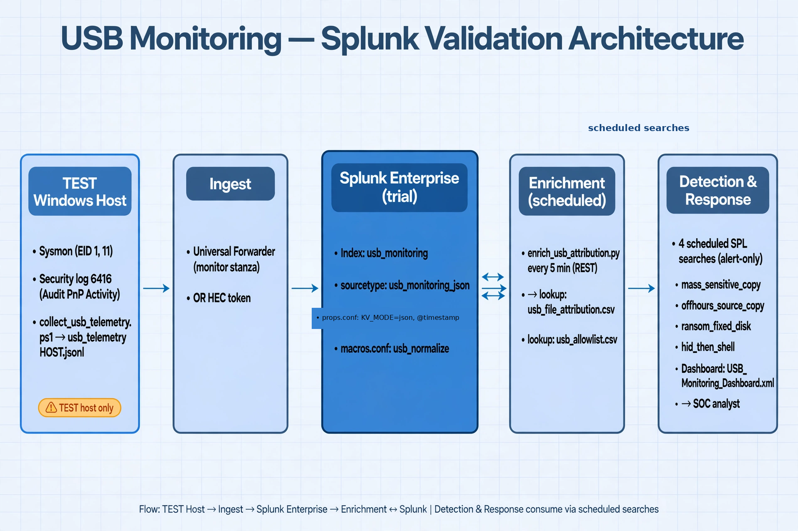

# ران‌بوک اعتبارسنجی روی Splunk زنده

> **قول صداقت:** هیچ اسکرین‌شات «آماده»ای در این بسته نیست. من به Splunk زنده
> دسترسی ندارم، پس اسکرین‌شاتی از «تست موفق» جعل نکرده‌ام. هر جا علامت 📷
> می‌بینی، یعنی نوبت توست: همان مدرک را از محیط خودت بگیر و در پوشهٔ
> `validation-evidence/` نگه دار (نام‌گذاری پیشنهادی پایین هر قدم آمده).

## پیش‌نیازها

- یک **هاست تست ویندوزی** (VM ترجیحاً). نه هاست production، نه لپ‌تاپ روزمره.
- یک فلش USB تست با سریال معلوم + یک کیبورد USB تست (برای تست HID).
- دسترسی Administrator به هاست تست و دسترسی admin به Splunk.
- فایل‌های تست بی‌خطر (مثلاً `customer_db_test1.csv`) — نه دیتای واقعی سازمان.

---

## گام ۰ — معماری را ببین



جریان: هاست تست (Sysmon + Audit PnP + کالکتور) ← UF یا HEC ← ایندکس
`usb_monitoring` ← جاب `enrich_usb_attribution.py` (هر ۵ دقیقه) ← lookup
`usb_file_attribution.csv` ← چهار سرچ زمان‌بندی‌شده (alert-only) ← تحلیل‌گر.

---

## گام ۱ — نصب Splunk Enterprise trial

1. از splunk.com نسخهٔ Enterprise trial را دانلود و روی ماشین Splunk نصب کن.
2. وارد Splunk Web شو.

> 📷 **مدرک لازم:** اسکرین‌شات صفحهٔ About (نسخه و نوع لایسنس) + صفحهٔ لاگین موفق.
> نام فایل: `01-splunk-version.png`
>
> ⚠️ طبق مستندات Splunk، trial حدود ۶۰ روز قابلیت Enterprise (از جمله alerting)
> دارد و بعد به Free با محدودیت حجم روزانه و **غیرفعال شدن alerting** تبدیل
> می‌شود. اعتبارسنجی را داخل بازهٔ trial انجام بده.

---

## گام ۲ — ساخت ایندکس و نصب app

1. پوشهٔ `splunk/` این ریپو را به `$SPLUNK_HOME/etc/apps/usb_monitoring/local/`
   کپی کن: `indexes.conf`، `props.conf`، `transforms.conf`، `macros.conf`،
   `USB_Monitoring_Dashboard.xml`.
2. از روی `splunk/lookups/usb_allowlist.example.csv` فایل واقعی
   `splunk/lookups/usb_allowlist.csv` را بساز (فعلاً همان یک سطر example کافی
   است؛ بعداً با سریال‌های واقعی پرش می‌کنی — شناسهٔ تستی را هرگز وارد
   production نکن).
3. Splunk را restart کن (یا app را reload).

> 📷 **مدرک لازم:**
> - `02-index.png` — صفحهٔ Settings → Indexes که ایندکس `usb_monitoring` را نشان بدهد.
> - `02-lookups.png` — خروجی سرچ `| inputlookup usb_allowlist.csv` (حداقل یک سطر).
> - `02-macros.png` — صفحهٔ Settings → Advanced Search → Search macros که
>   `usb_normalize` را نشان بدهد.

---

## گام ۳ — فعال‌سازی Audit PnP Activity و Sysmon (فقط هاست تست)

> ⛔ این قدم را روی هیچ هاست production اجرا نکن.

1. **Audit PnP Activity** (برای رویداد 6416):
   - مسیر GPO: Computer Configuration → Windows Settings → Security Settings →
     Advanced Audit Policy Configuration → System Audit Policies → **Audit PNP Activity**
     را روی Success بگذار. یا با `auditpol` (اول با `auditpol /get /category:*`
     اسم دقیق subcategory را چک کن).
2. **Sysmon**: از Sysinternals دانلود کن، هش را چک کن، با یک کانفیگ معتبر
   (مثلاً SwiftOnSecurity) نصب کن. برای این اعتبارسنجی EID 1 و EID 11 لازم است.
3. یک فلش تست را وصل کن و در Event Viewer دنبال Security/6416 بگرد.

> 📷 **مدرک لازم:**
> - `03-auditpol.png` — خروجی دستور auditpol که فعال بودن PNP Activity را نشان بدهد.
> - `03-6416.png` — یک رویداد 6416 واقعی در Event Viewer بعد از اتصال فلش تست.
> - `03-sysmon.png` — سرویس Sysmon در حال اجرا (services.msc) یا خروجی
>   `Get-Service Sysmon64`.

---

## گام ۴ — اینجست: UF یا HEC

یکی را انتخاب کن (هر دو در فصل ۳ مستند شده):

- **UF**: فایل‌های jsonl کالکتور را در `C:\ProgramData\usb-monitoring\` بریز و
  stanza داده‌شده در `docs/03-splunk-ingestion.md` را به `inputs.conf` اضافه کن.
- **HEC**: توکن بساز (دسترسی فقط به ایندکس `usb_monitoring`) و در credential
  store نگه دار.

بعد این را اجرا کن:

```spl
index=usb_monitoring sourcetype=usb_monitoring_json earliest=-24h
| stats count min(_time) as first max(_time) as last
| eval first=strftime(first,"%Y-%m-%dT%H:%M:%SZ"), last=strftime(last,"%Y-%m-%dT%H:%M:%SZ")
```

> 📷 **مدرک لازم:**
> - `04-ingest.png` — خروجی همین سرچ: `count > 0` و `first/last` باید زمان
>   واقعی endpoint باشند، نه «چند ثانیه پیش» (وگرنه `_time` زمان ingestion است
>   و attribution خراب می‌شود — فصل ۳.۳).

---

## گام ۵ — اجرای `collect_usb_telemetry.ps1` و اعتبارسنجی فیلدها

1. روی هاست تست، به‌صورت Administrator اجرا کن:
   `powershell -ExecutionPolicy Bypass -File scripts\collect_usb_telemetry.ps1`
2. خلاصهٔ خروجی را بخوان: `usbstor_classes`، `security_6416_sampled`، `sysmon_present`.
3. این سرچ را بزن و مطمئن شو `usb.volume_letter` و `usb.serial_number` رسیده‌اند:

```spl
index=usb_monitoring sourcetype=usb_monitoring_json event.code=6416
| `usb_normalize`
| table _time host usb_serial usb_letter usb_class
```

> 📷 **مدرک لازم:**
> - `05-collector-summary.png` — خروجی summary اسکریپت در کنسول.
> - `05-fields.png` — چند سطر خروجی سرچ بالا که `usb_serial` و `usb_letter`
>   پر باشند (نه خالی).
>
> اگر `usb_letter` خالی است، قبل از ادامه مشکل volume mapping را حل کن —
> بدون حرف درایو، attribution کار نمی‌کند (فصل ۱۰.۱).

---

## گام ۶ — اجرای `enrich_usb_attribution.py` و زمان‌بندی

1. متغیرهای محیطی را ست کن (`SPLUNK_URL`، `SPLUNK_TOKEN`، ... — توکن را در فایل
   ننویس) و یک بار دستی اجرا کن:
   `python scripts/enrich_usb_attribution.py --file-window-minutes 1560 --session-lookback-hours 48`
2. چند سطر اول `splunk/lookups/usb_file_attribution.csv` را چک کن.
3. زمان‌بندی‌اش کن (هر ۵ دقیقه): cron یا Windows Task Scheduler.

> 📷 **مدرک لازم:**
> - `06-attribution-rows.png` — چند سطر از `usb_file_attribution.csv`
>   (host, file_path, usb_serial پر).
> - `06-lookup-count.png` — خروجی `| inputlookup usb_file_attribution.csv | stats count`.
> - `06-schedule.png` — اسکرین‌شات تسک زمان‌بندی‌شده (آخرین اجرای موفق + زمان بعدی).
>
> ⚠️ اگر این جاب بمیرد، رول‌های mass و offhours **ساکت** می‌میرند. برای خود جاب
> یک آلارم freshness بگذار (فصل ۱۰.۳).

---

## گام ۷ — دیپلوی چهار رول در حالت alert-only

1. هر چهار فایل `detections/splunk/*.spl` را اول **دستی** اجرا کن؛ فقط وقتی
   شکل خروجی با «expected» هدر فایل یکی بود، به‌صورت alert ذخیره‌اش کن.
2. scheduleها طبق هدر هر فایل (mass: هر ۵ دقیقه، offhours: هر ۱ ساعت،
   ransom: هر ۱ دقیقه، hid: هر ۵ دقیقه).
3. action = فقط ثبت/ایمیل به خودت. severity را یک درجه پایین‌تر از نهایی بگذار.
   به on-call وصل نکن.

> 📷 **مدرک لازم:**
> - `07-alerts-list.png` — صفحهٔ Settings → Searches, Reports, and Alerts:
>   هر چهار رول با schedule و حالت enabled دیده شوند.
> - `07-manual-run.png` — خروجی دستی هر چهار سرچ (حتی اگر خالی است؛ خالی بودن
>   قبل از تست طبیعی است).

---

## گام ۸ — تست‌های ۱ تا ۶ فصل ۱۰ با USB واقعی

از یک فلش **تست** با سریال معلوم استفاده کن. فایل‌های تست بی‌خطر بساز
(مثلاً `customer_db_test1.csv`) — نه دیتای واقعی.

| تست | کار | انتظار | 📷 مدرک |
|---|---|---|---|
| ۱ attribution | فلش را وصل کن، یک فایل بساز، جاب را اجرا کن | یک سطر در `usb_file_attribution.csv` با path و serial درست | `08-t1-attribution.png` — خروجی سرچ تست ۱ فصل ۱۰ |
| ۲ mass | پنج فایل `customer_db_test*.csv` در ۳۰ دقیقه | **یک** آلارم mass-copy؛ تک‌فایل آلارم ندهد | `08-t2-alert.png` — جزئیات آلارم (host/user/serial/نمونه فایل‌ها) |
| ۳ offhours | ۲۰ فایل `.cs` در ساعت تست (یا موقتاً مرز ساعت را عوض کن) | **یک** آلارم off-hours | `08-t3-alert.png` |
| ۴ ransom | اسکریپت بی‌خطر: ۱۵ فایل `.locked` روی `C:` از یک پروسس در ۱۸۰ ثانیه | **یک** آلارم ransom با process و host | `08-t4-alert.png` |
| ۵ HID+shell | کیبورد تست (خارج از allowlist) + `powershell -NoProfile -Command "Get-Date"` در ۶۰ ثانیه | **یک** آلارم؛ بعد دستگاه را به allowlist تست اضافه کن و تکرار کن → **بدون** آلارم (این همان باگی بود که فیکس شد — تست ۵.۴ حیاتی است) | `08-t5-alert.png` + `08-t5-suppressed.png` (اجرای دوم بدون آلارم) |
| ۶ کنترل‌های benign | تک‌فایل حساس، ۳ سورس در ساعت کاری، یک `.locked` تکی، پاورشل بدون HID، HID بدون شل | **هیچ** آلارم critical | `08-t6-clean.png` — سرچ آلارم‌ها در بازهٔ تست که خالی است |

نتیجه‌ها را در این جدول ثبت کن (در همان پوشهٔ `validation-evidence/`):

| تست | تاریخ | هاست | سریال دستگاه | انتظار | نتیجهٔ واقعی | فایل مدرک |
|---|---|---|---|---|---|---|
| ۱ | | | | | | |

---

## گام ۹ — اعتبارسنجی داشبورد

` splunk/USB_Monitoring_Dashboard.xml` را باز کن و بازهٔ زمانی را روی زمان
تست‌ها بگذار.

> 📷 **مدرک لازم:**
> - `09-dashboard.png` — داشبورد کامل با پنل‌های پرشده (اتصال‌ها، فایل‌های
>   منتسب با serial، پنل HID، پنل locked).
> - اگر پنلی خالی است ولی نباید باشد، اول health جاب/lookup را چک کن
>   (فصل ۱۰.۳) — خالی بودنِ «موفق» دروغ است.

---

## گام ۱۰ — جمع‌بندی

چک‌لیست «validated یعنی چه» (فصل ۱۰.۵) را سطر‌به‌سطر تیک بزن. اگر همه سبز بود،
پروژه آمادهٔ فاز بعدی است: **دو هفته alert-only روی production** و بعد تیونینگ
(راهنما: پروژهٔ `usb-monitoring-lab`، سند `docs/tuning-runbook.md`).

> بعد از هر تغییر (mapping، کالکتور، جاب، SPL، allowlist، داشبورد) تست‌های
> بالا را دوباره اجرا کن — فصل ۱۰.۷.
